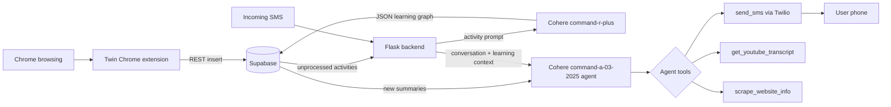

# Twin

Submitted to Hack The North 2025.

Twin is an SMS-first learning companion that watches a user's browsing activity, turns that activity into structured learning context, and uses Cohere to decide when and how to text the user useful follow-ups. The project combines a Chrome extension, a Supabase data layer, a Flask backend, Twilio SMS, and a Cohere-powered agent that can summarize browsing sessions, inspect learning resources, and send short contextual messages.

## Table of Contents

- [What Twin Does](#what-twin-does)
- [Interactive System Map](#interactive-system-map)
- [Repository Layout](#repository-layout)
- [Core User Flow](#core-user-flow)
- [Cohere Implementation](#cohere-implementation)
- [Backend API](#backend-api)
- [Chrome Extension](#chrome-extension)
- [Local Setup](#local-setup)
- [Environment Variables](#environment-variables)
- [Supabase Data Model](#supabase-data-model)
- [Testing the Cohere Flows](#testing-the-cohere-flows)
- [Development Notes](#development-notes)
- [Privacy Notes](#privacy-notes)

## What Twin Does

Twin helps users learn from what they already browse.

1. A user signs up by SMS or through the Chrome extension.
2. The Chrome extension tracks page visits, navigation, searches, clicks, and time-on-page events.
3. Activity rows are saved to Supabase with `processed = false`.
4. The Flask backend batches unprocessed activity per user.
5. Cohere converts those browsing events into a structured learning map.
6. A second Cohere agent reviews new summaries, conversation history, and incoming SMS messages.
7. The agent uses tools to text the user, fetch YouTube transcripts, or scrape web pages.
8. Twilio delivers the final learning nudges and replies over SMS.

## Interactive System Map

<details open>
<summary><strong>End-to-end architecture</strong></summary>



</details>

<details>
<summary><strong>Click through the main runtime paths</strong></summary>

| Path | Trigger | Cohere role | Output |
| --- | --- | --- | --- |
| Activity analysis | `POST /api/analyze-users` | Convert raw browsing activity into structured learning summaries | Rows in `summaries` |
| Summary processing | `POST /api/process-summaries` | Decide whether recent learning deserves a text follow-up | 0 or more SMS messages |
| Incoming SMS | `POST /sms` from Twilio | Reply with context from message history and recent learning | SMS conversation |
| Local agent test | `test_cohere_agent()` in `app.py` | Execute a custom instruction with tools | Agent metadata and sent texts |

</details>

## Repository Layout

```text
.
|-- README.md                         # Project-level documentation
|-- INTELLIGENT_RESPONSE_README.md    # Older focused note for SMS response prompting
|-- system_prompt.txt                 # Last generated intelligent response prompt
|-- supabase/
|   `-- flask/
|       |-- app.py                    # Flask API, Supabase access, Twilio, Cohere flows
|       |-- app2.py                   # Alternate Flask file
|       |-- requirements.txt          # Python dependency seed
|       `-- reset_twilio_number.py    # Utility script
|-- twin-raw/
|   |-- manifest.json                 # Chrome extension manifest
|   |-- service-worker.js             # Extension service worker entry
|   |-- sw-auth.js                    # Supabase-backed sign in/sign up
|   |-- sw-activity.js                # Activity persistence into Supabase
|   |-- activity-tracker.js           # Content script activity capture
|   |-- popup.html
|   |-- popup.js
|   `-- README.md                     # Extension-specific setup notes
|-- twin/
|   |-- app/                          # Next.js app scaffold
|   |-- package.json
|   `-- next.config.ts
`-- twin-raw.zip                      # Packaged extension artifact
```

## Core User Flow

<details open>
<summary><strong>1. Onboarding by SMS</strong></summary>

The Twilio webhook at `POST /sms` receives the first message from a phone number. The backend gates the user through:

- `registration`: create a Supabase `users` row with `phone_number` and `onboarding_state = awaiting_email`
- `email`: validate and store the user's email
- `name`: store the user's name and set `onboarding_state = complete`

Once onboarding is complete, incoming texts use the full Cohere response flow.

</details>

<details open>
<summary><strong>2. Browsing capture</strong></summary>

The Chrome extension stores a signed-in user in `chrome.storage.local`, checks whether tracking is enabled, and writes activity rows to Supabase. The important activity fields are:

- `user_id`
- `url`
- `title`
- `domain`
- `timestamp`
- `processed`

The backend only summarizes rows where `processed = false`.

</details>

<details open>
<summary><strong>3. Learning nudges</strong></summary>

The backend periodically or manually processes users:

1. `analyze_all_users()` finds users and launches bounded worker threads.
2. `process_user_with_cohere()` collects unprocessed browsing rows.
3. Cohere generates a JSON learning graph and key-resource list.
4. The summary is saved to Supabase.
5. The source activity rows are marked processed.
6. `process_user_summaries()` reviews new summaries.
7. `execute_cohere_agent()` decides whether to send short, useful SMS nudges.

</details>

## Cohere Implementation

Cohere is the center of the intelligence layer. The backend uses `cohere.ClientV2` in `supabase/flask/app.py` and separates the work into two distinct model responsibilities.

### 1. Structured browsing analysis

Function: `process_user_with_cohere()`

Model: `command-r-plus`

Purpose: convert a batch of raw browsing events into structured learning context.

The prompt asks Cohere to return only JSON with this shape:

```json
{
  "learning_overview": {
    "primary_focus": "main topic",
    "secondary_topics": ["related topic"],
    "level": "beginner|intermediate|advanced",
    "total_urls": 12
  },
  "learning_graph": {
    "topic_name": {
      "relevance_score": 0.9,
      "subtopics": {
        "subtopic": {
          "urls": [
            {
              "url": "https://example.com",
              "title": "Resource title",
              "domain": "example.com",
              "timestamp": "ISO timestamp",
              "value": "high|medium|low",
              "type": "tutorial|docs|video|article|course",
              "why": "brief relevance note"
            }
          ]
        }
      }
    }
  },
  "key_resources": {
    "high_value": [],
    "for_ai_analysis": []
  },
  "patterns": {
    "behavior": "how they browse and learn",
    "gaps": [],
    "progress": []
  }
}
```

Implementation details:

- Reads from `activities` where `processed = false`.
- Skips very recent activity by default so the user has time to finish a browsing burst.
- Includes timestamp, domain, page title, and full URL in the prompt.
- Uses `response_format={"type": "json_object"}` to force structured output.
- Saves the prompt, response content, finish reason, token usage, and source activity IDs to `summaries`.
- Marks source activities as processed only after the summary is saved.

Why this matters: the first Cohere pass is not trying to chat. It creates durable user memory that future SMS responses can use.

### 2. Tool-calling SMS agent

Function: `execute_cohere_agent()`

Model: `command-a-03-2025`

Purpose: act on a prompt by using tools and sending SMS messages.

Available tools:

| Tool | Backing function | What it does |
| --- | --- | --- |
| `send_sms` | `send_sms()` | Sends a short Twilio SMS to the user |
| `get_youtube_transcript` | `get_youtube_transcript()` | Extracts transcript text from a YouTube URL |
| `scrape_website_info` | `scrape_website_info()` | Fetches readable page text from a website |

Agent loop:

1. Start with a user prompt.
2. Call Cohere with tool definitions.
3. If Cohere requests tools, execute each tool locally.
4. Append tool results back into the message list.
5. Continue for up to `max_iterations = 5`.
6. Return final response, tools used, SMS messages sent, and token usage.

This makes Twin more than a text generator. The Cohere agent can inspect a YouTube video, read a web page, and then break the result into multiple short SMS messages.

### 3. Intelligent incoming SMS prompts

Function: `create_intelligent_response_prompt()`

Purpose: build a high-context instruction for incoming Twilio messages.

The prompt includes:

- The current inbound SMS
- The sender phone number
- Recent Twilio conversation history
- Learning summaries from the past 36 hours
- Hard rules that every conversational turn must end with `send_sms`
- A texting style guide for short, digestible messages
- Tool-use workflows for videos, websites, and browsing-history questions

The generated prompt is written to `system_prompt.txt` for debugging.

### 4. Proactive summary processing

Function: `process_user_summaries()`

Purpose: decide whether new learning summaries are worth texting about.

This flow gives Cohere both old and new summary context:

- Processed summaries become "already covered" context.
- Unprocessed summaries become "new learning" context.
- Recent SMS messages help avoid repetitive nudges.

If the agent sends messages successfully, the new summaries are marked `processed = true`.

### 5. Why the Cohere split is useful

The implementation intentionally separates memory creation from action:

- `command-r-plus` creates structured, reusable learning memory from browsing activity.
- `command-a-03-2025` makes real-time decisions and uses tools.
- Supabase stores model output, prompts, source IDs, and processing state so the system can resume safely.
- Twilio is only called through the tool layer, which makes SMS delivery auditable in the agent result.

## Backend API

Base URL during local development:

```text
http://localhost:3067
```

### `GET /`

Returns service metadata, configured endpoints, and available agent tools.

```bash
curl http://localhost:3067/
```

### `GET /health`

Checks whether required service credentials are present.

```bash
curl http://localhost:3067/health
```

Example response shape:

```json
{
  "status": "healthy",
  "services": {
    "cohere": "connected",
    "supabase": "connected",
    "twilio": "connected"
  }
}
```

### `POST /api/analyze-users`

Runs Cohere activity analysis for all users.

```bash
curl -X POST http://localhost:3067/api/analyze-users
```

### `POST /api/process-summaries`

Runs the Cohere SMS agent over recent summaries and sends text nudges when useful.

```bash
curl -X POST http://localhost:3067/api/process-summaries
```

### `POST /sms`

Twilio webhook for inbound SMS messages.

Configure this URL in Twilio. For local testing, expose the Flask app with a tunnel such as ngrok and point Twilio to:

```text
https://YOUR-TUNNEL.ngrok-free.app/sms
```

## Chrome Extension

The active extension code is in `twin-raw/`.

### Install locally

1. Open `chrome://extensions`.
2. Enable Developer Mode.
3. Click "Load unpacked".
4. Select the `twin-raw` folder.
5. Open the Twin extension popup.
6. Sign up or sign in with email/phone.
7. Toggle tracking on or off from the popup.

### Extension components

| File | Role |
| --- | --- |
| `manifest.json` | Manifest V3 extension config |
| `service-worker.js` | Imports auth, activity, omnibox, and tips modules |
| `sw-auth.js` | Supabase user sign up, sign in, update, and tracking toggle |
| `sw-activity.js` | Saves activity rows and retrieves last activity |
| `activity-tracker.js` | Tracks page-level actions from content scripts |
| `popup.html` / `popup.js` | Extension UI |

### Important configuration

Supabase URL and anon key are currently hardcoded in:

- `twin-raw/sw-auth.js`
- `twin-raw/sw-activity.js`

For production, move those values into a safer build/config path and review Supabase row-level security policies.

## Local Setup

### 1. Backend

```bash
cd supabase/flask
python -m venv .venv
.venv\Scripts\activate
pip install -r requirements.txt
```

The current backend imports additional packages beyond the seed requirements file. If you are setting up from a clean environment, install these too:

```bash
pip install supabase cohere youtube-transcript-api requests beautifulsoup4
```

Create `.env` in `supabase/flask/`:

```env
TWILIO_ACCOUNT_SID=your_twilio_account_sid
TWILIO_AUTH_TOKEN=your_twilio_auth_token
TWILIO_PHONE_NUMBER=+15555555555
COHERE_API_KEY=your_cohere_api_key
SUPABASE_URL=https://your-project.supabase.co
SUPABASE_PUBLISHABLE_KEY=your_supabase_publishable_or_anon_key
```

Run the Flask server:

```bash
python app.py
```

The server listens on:

```text
http://localhost:3067
```

### 2. Next.js app scaffold

The `twin/` folder currently contains a stock Next.js app scaffold.

```bash
cd twin
npm install
npm run dev
```

Open:

```text
http://localhost:3000
```

### 3. Chrome extension

Load `twin-raw/` as an unpacked Chrome extension after Supabase is configured.

## Environment Variables

| Variable | Used by | Required for |
| --- | --- | --- |
| `TWILIO_ACCOUNT_SID` | Flask backend | Sending SMS and reading message history |
| `TWILIO_AUTH_TOKEN` | Flask backend | Twilio API access |
| `TWILIO_PHONE_NUMBER` | Flask backend | Sender number for `send_sms` |
| `COHERE_API_KEY` | Flask backend | Cohere summary and agent calls |
| `SUPABASE_URL` | Flask backend | Supabase client |
| `SUPABASE_PUBLISHABLE_KEY` | Flask backend | Supabase client |

## Supabase Data Model

The code expects these core tables and fields.

### `users`

| Field | Purpose |
| --- | --- |
| `id` | User primary key |
| `email` | User email, collected by SMS or extension |
| `phone_number` | User SMS identity |
| `name` | Personalization |
| `is_active` | Active-user flag |
| `onboarding_state` | `awaiting_email`, `awaiting_name`, or `complete` |

### `activities`

| Field | Purpose |
| --- | --- |
| `id` | Activity primary key |
| `user_id` | Owner |
| `url` | Visited URL |
| `title` | Page title |
| `domain` | Page domain |
| `timestamp` | Activity time |
| `processed` | Whether Cohere has summarized it |

### `summaries`

| Field | Purpose |
| --- | --- |
| `id` | Summary primary key |
| `user_id` | Owner |
| `summary` | Cohere response content |
| `cohere_finish_reason` | Cohere finish metadata |
| `cohere_usage` | Token usage |
| `cohere_prompt` | Prompt sent to Cohere |
| `source_activity_ids` | Activity rows used for the summary |
| `prompt_generated_at` | Summary creation time |
| `processed` | Whether the SMS-agent pass has handled it |

## Testing the Cohere Flows

### Check service configuration

```bash
curl http://localhost:3067/health
```

### Analyze unprocessed browsing activity

```bash
curl -X POST http://localhost:3067/api/analyze-users
```

Expected result:

- Cohere receives browsing activity.
- A summary row is inserted into Supabase.
- Related activity rows become `processed = true`.

### Process summaries into SMS nudges

```bash
curl -X POST http://localhost:3067/api/process-summaries
```

Expected result:

- Cohere reviews new summaries.
- The agent decides whether the user should be texted.
- If useful, Twilio sends 2-4 short SMS messages.
- Successfully handled summaries become `processed = true`.

### Test incoming SMS locally

Use Twilio's webhook tester or tunnel the local backend:

```bash
ngrok http 3067
```

Set the Twilio messaging webhook to:

```text
https://YOUR-TUNNEL.ngrok-free.app/sms
```

Then text the Twilio number. For onboarded users, the backend will build an intelligent Cohere prompt using message history and recent learning summaries.

## Development Notes

- `VERBOSE_LOGGING` in `supabase/flask/app.py` controls detailed backend logs.
- `test_mode` at the bottom of `app.py` controls what runs when the file is executed directly.
- The Flask server default is `app.run(debug=False, host='0.0.0.0', port=3067, threaded=True)`.
- Cohere agent execution is capped at five tool-use iterations.
- The root endpoint advertises `/api/cohere-agent`, but `app.py` does not currently define that Flask route. Use `test_cohere_agent()` directly or add the route before documenting it as a public API.
- `system_prompt.txt` is overwritten whenever `create_intelligent_response_prompt()` runs.
- The Python requirements file does not currently list every imported package; install the extra packages shown in [Local Setup](#local-setup) for clean machines.
- Some log strings appear with mojibake in the source because emoji text was encoded incorrectly at some point. The behavior is still readable enough for debugging, but cleaning source encoding would improve maintainability.

## Privacy Notes

Twin stores browsing activity, URLs, phone numbers, SMS context, and model prompts. Treat the Supabase project and Twilio logs as sensitive.

Recommended hardening before real users:

- Review Supabase row-level security for `users`, `activities`, and `summaries`.
- Avoid committing live Supabase anon keys or service credentials.
- Move extension Supabase config out of hardcoded source files.
- Add explicit consent copy around browsing activity tracking.
- Add a retention policy for activity rows, summaries, and Twilio conversation context.
- Add opt-out commands for SMS and tracking.

## Quick Demo Script

1. Start Flask:

   ```bash
   cd supabase/flask
   .venv\Scripts\activate
   python app.py
   ```

2. Confirm services:

   ```bash
   curl http://localhost:3067/health
   ```

3. Load `twin-raw/` in Chrome.

4. Sign in through the extension and browse learning resources.

5. Run:

   ```bash
   curl -X POST http://localhost:3067/api/analyze-users
   ```

6. Run:

   ```bash
   curl -X POST http://localhost:3067/api/process-summaries
   ```

7. Text the Twilio number to ask about what you were learning.

Twin should answer with context from your recent browsing, prior summaries, and SMS history.
